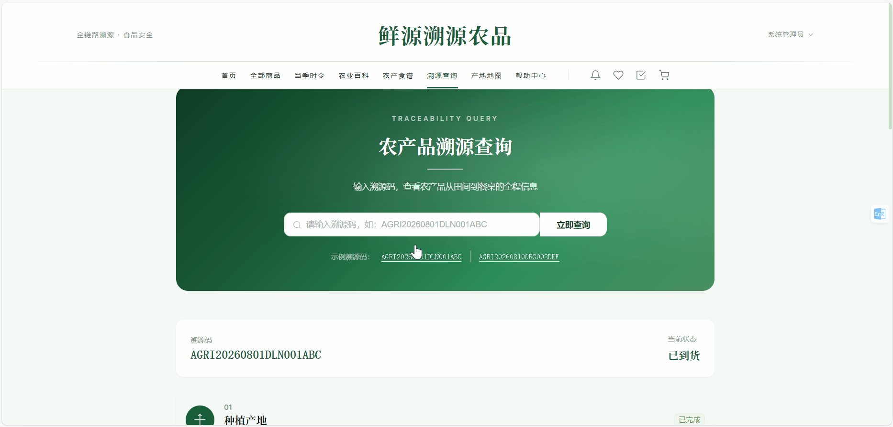
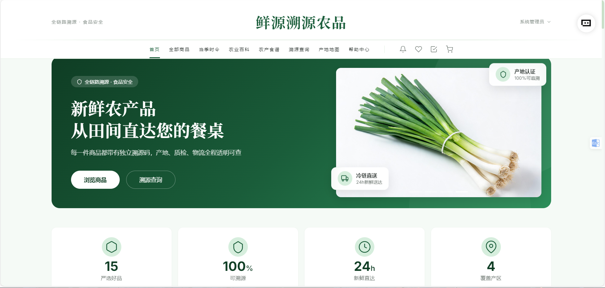
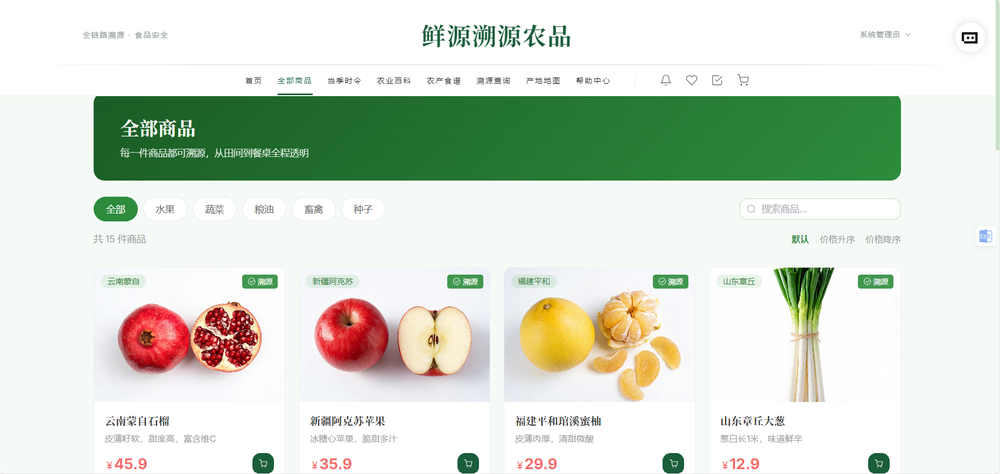
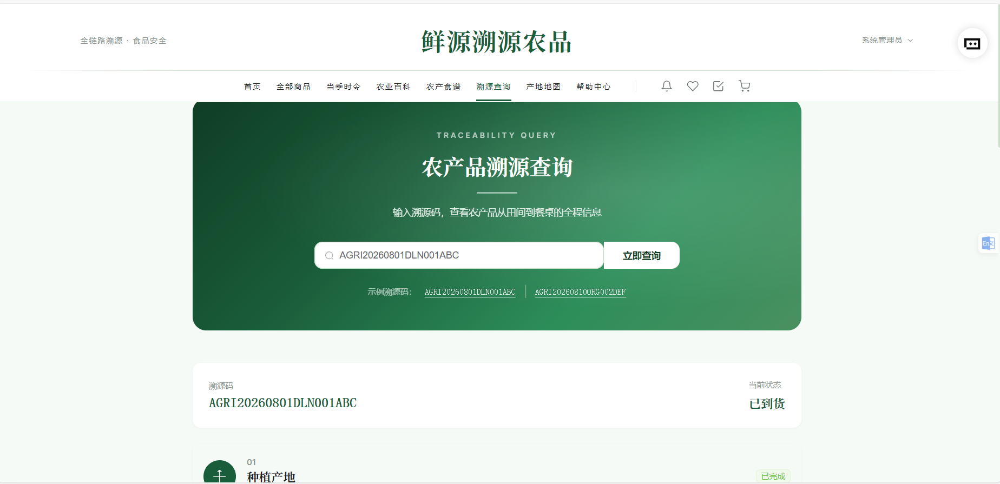
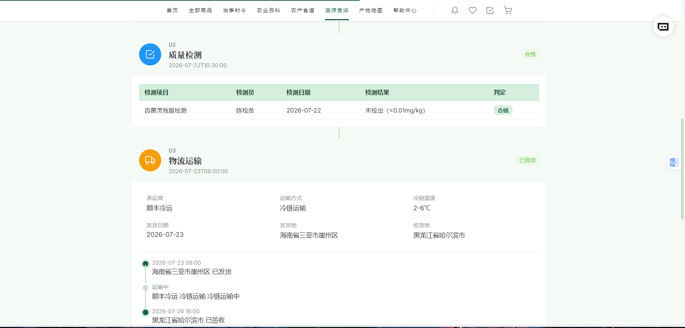
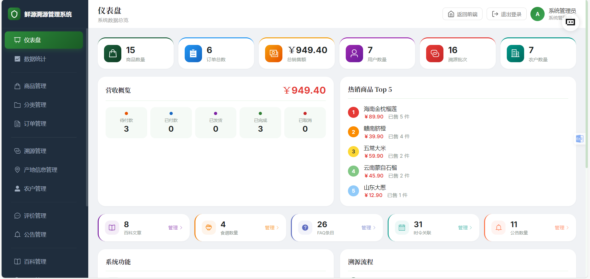
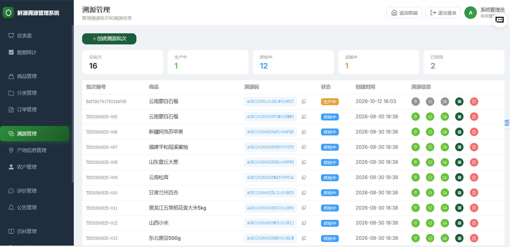
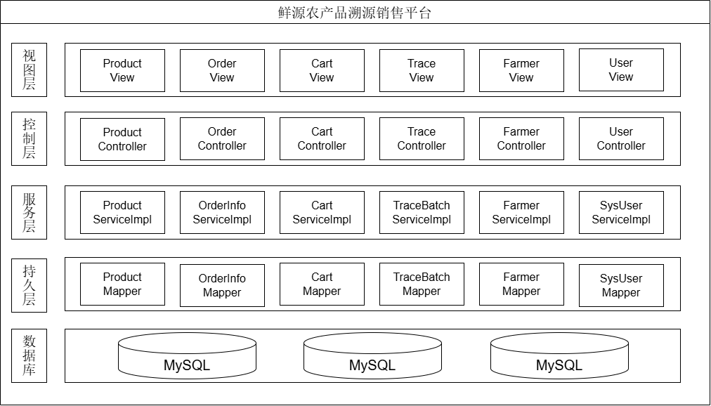
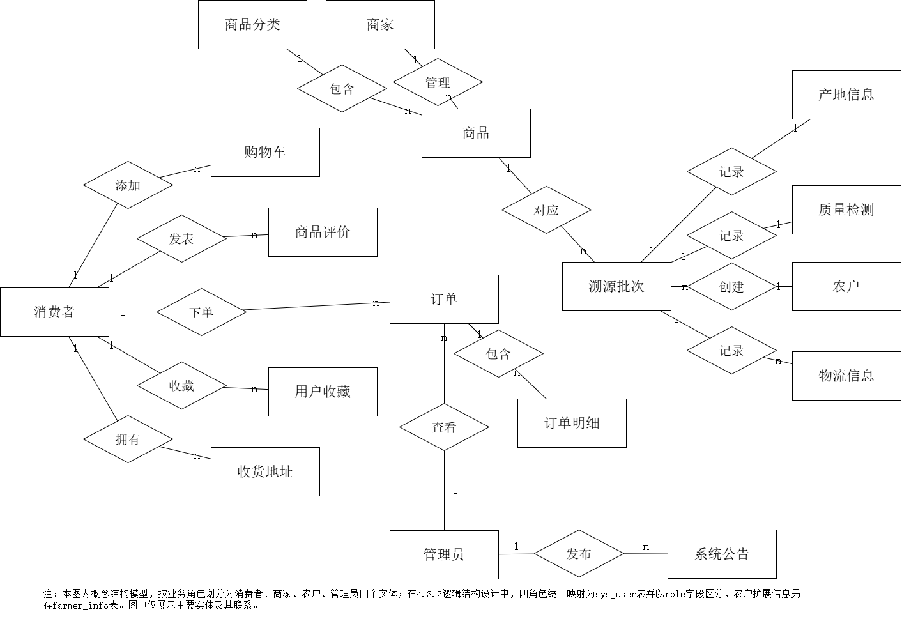
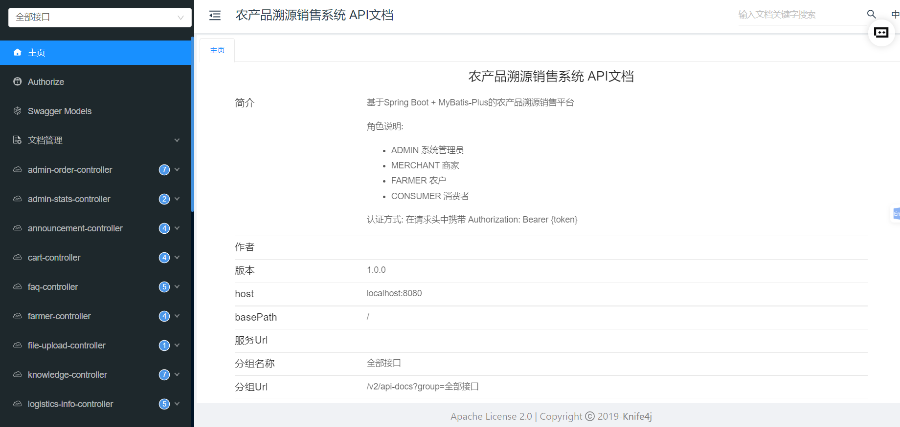

# 鲜源农产品溯源销售平台


> 一套面向农产品电商的「**销售 + 全程溯源**」一体化平台：消费者下单前可扫码查看产地、质检、物流全链路信息，农户与商家在后台维护溯源批次数据。

本科毕业设计项目。后端 Spring Boot + MyBatis-Plus，前端 Vue 3 + Element Plus，前后端分离部署。

- 仓库：<https://github.com/Huashi25/agri-traceability>
- 在线接口文档：启动后端后访问 <http://localhost:8080/doc.html>

---

## 一、项目简介

平台围绕农产品流通中最核心的信任问题展开：消费者无法确认买到的是否真的来自宣称的产地、是否经过质检、运输环节是否可靠。系统把每一批农产品抽象为一个**溯源批次（TraceBatch）**，为批次挂载**产地信息、质检报告、物流轨迹**三类关键数据，并生成全局唯一的溯源码。消费者在前端输入或扫描溯源码，即可一次性看到这批产品从田间到餐桌的完整链路。

在溯源能力之上，系统实现了完整的电商交易闭环：商品与分类管理、购物车、下单结算、库存扣减、订单状态流转、评价、收藏、收货地址、站内通知。同时提供内容侧的增值模块——时令农产品推荐、农业百科文章、农产食谱（含食材关联）、常见问题与公告，用于提升用户留存。

后台按角色划分权限，支持**系统管理员（ADMIN）、商家（MERCHANT）、农户（FARMER）、消费者（CONSUMER）**四种角色。农户角色只能维护与自己相关的产地与批次数据，商家负责商品与订单，管理员拥有全部权限。

---

## 二、技术栈

| 层次 | 技术 | 版本 | 说明 |
|---|---|---|---|
| 后端框架 | Spring Boot | 2.7.18 | JDK 1.8 |
| ORM | MyBatis-Plus | 3.5.3.1 | 含分页插件、逻辑删除配置 |
| 安全 | JJWT + Spring Security Crypto | 0.9.1 / 5.7.11 | JWT 鉴权 + BCrypt 密码加密 |
| 数据库 | MySQL | 8.x（驱动 8.0.33） | 库名 `agri_traceability`，utf8mb4 |
| 缓存 | Redis（Lettuce 连接池） | Spring Boot 2.7 内置 | 溯源查询结果缓存 |
| 接口文档 | Knife4j | 3.0.3 | 启动后访问 `/doc.html` |
| 前端框架 | Vue 3 | ^3.4.0 | Composition API |
| 前端构建 | Vite | ^5.0.0 | |
| UI 组件库 | Element Plus | ^2.5.0 | 含 `@element-plus/icons-vue` |
| 状态管理 | Pinia | ^4.0.3 | `user` / `cart` 两个 store |
| 路由 | Vue Router | ^4.2.5 | 路由守卫做登录与角色校验 |
| HTTP | Axios | ^1.6.5 | 统一拦截器封装 |
| 其他 | qrcode、@vueuse/core | | 溯源码二维码生成 |

---

## 三、功能模块

### 3.1 消费者端（`/`）

| 模块 | 页面 | 主要接口 |
|---|---|---|
| 首页 | `Home.vue` | 商品推荐、公告、限时优惠 |
| 商品浏览 | `ProductList.vue`、`ProductDetail.vue` | `/api/product`、`/api/category` |
| **溯源查询** | `TraceQuery.vue` | `/api/trace/query/{traceCode}` |
| 溯源流程展示 | `TraceProcess.vue` | `/api/quality`（质量标准） |
| 质量标准 | `QualityStandards.vue` | `/api/quality` |
| 农户与产地 | `Farmers.vue`、`FarmerDetail.vue` | `/api/farmer`、`/api/origin` |
| 产地地图 | `OriginMap.vue` | 基于农户经纬度展示产区分布 |
| 时令推荐 | `Seasonal.vue` | `/api/seasonal` |
| 农业百科 | `Knowledge.vue`、`KnowledgeDetail.vue` | `/api/knowledge` |
| 农产食谱 | `Recipes.vue`、`RecipeDetail.vue` | `/api/recipe` |
| 帮助中心 | `Help.vue` | `/api/faq` |
| 公告 | `Announcements.vue` | `/api/announcement` |
| 购物车 | `Cart.vue` | `/api/cart` |
| 下单与订单 | — | `/api/order/checkout`、`/api/order/pay|cancel|ship|confirm` |
| 我的订单 | `Orders.vue` | `/api/order` |
| 收藏 / 地址 / 通知 / 个人中心 | `Favorites.vue`、`Profile.vue`、`Notifications.vue` | `/api/favorite`、`/api/address`、`/api/notification`、`/api/user` |

### 3.2 管理后台（`/admin`）

| 模块 | 页面 | 可见角色 |
|---|---|---|
| 数据看板 | `Dashboard.vue` | ADMIN / MERCHANT / FARMER |
| 商品管理 | `ProductManage.vue` | ADMIN / MERCHANT |
| 分类管理 | `CategoryManage.vue` | ADMIN |
| 订单管理 | `OrderManage.vue` | ADMIN / MERCHANT |
| 溯源批次管理 | `TraceManage.vue` | ADMIN / MERCHANT / FARMER |
| 产地信息管理 | `OriginManage.vue` | ADMIN / FARMER |
| 农户管理 | `FarmerManage.vue` | ADMIN / FARMER |
| 评价管理 | `ReviewManage.vue` | ADMIN / MERCHANT |
| 百科管理 | `KnowledgeManage.vue` | ADMIN / MERCHANT |
| 食谱管理 | `RecipeManage.vue` | ADMIN / MERCHANT |
| 常见问题管理 | `FaqManage.vue` | ADMIN |
| 时令管理 | `SeasonalManage.vue` | ADMIN |
| 公告管理 | `AnnouncementManage.vue` | ADMIN |
| 数据统计 | `DataStatistics.vue` | ADMIN / MERCHANT |
| 用户管理 | `UserManage.vue` | ADMIN |

权限映射维护在前端 `frontend/src/views/admin/AdminLayout.vue` 的 `rolePermissions` 中，与后端 `@RequireRole` 注解双重校验。

### 3.3 溯源数据模型

一次溯源查询返回 5 段数据（`common/TraceQueryVO.java`）：

```
TraceBatch        批次信息（批次号、溯源码、状态）
  ├─ Product      商品信息
  ├─ OriginInfo   产地信息（农场、地块、种植/采收日期、经纬度）
  ├─ QualityInspection  质检报告（检测项、结果、检测机构）
  └─ LogisticsInfo      物流轨迹（承运商、运输温度、签收状态）
```

溯源码格式：`AGRI + 8位日期 + 3位品类码 + 3位流水号 + 3位随机字母`（如 `AGRI20260801DLN001ABC`），生成逻辑见 `TraceBatchServiceImpl.generateTraceCode()`。

---

## 四、项目中几个值得一提的实现

以下均为代码中实际存在的实现，不是设计设想：

1. **防超卖的原子库存扣减** —— `ProductMapper` 中 `UPDATE product SET stock = stock - #{quantity} WHERE id = #{productId} AND stock >= #{quantity} AND status = 1`，把库存判断与扣减放在同一条 SQL 里，利用行锁保证并发安全，无需额外分布式锁。
2. **溯源查询缓存与降级** —— `TraceBatchServiceImpl.queryByTraceCode()` 先查 Redis（key `trace:query:{traceCode}`，TTL 10 分钟），未命中再查库并回写。缓存服务 `CacheService.get()` 内部做了异常兜底，Redis 不可用时自动降级为直接查库，不影响主流程。
3. **批量查询消除 N+1** —— 订单、购物车、食谱、时令、收藏等列表接口，先用 `in(...)` / `listByIds` 一次性取回关联数据再用 `Collectors.toMap` 组装，避免逐条查询（见 `AdminStatsController`、`CartController`、`RecipeController`、`SeasonalController`、`UserFavoriteController`）。
4. **密码加密与平滑迁移** —— 密码使用 BCrypt 存储；`PasswordMigrationRunner` 在应用启动时扫描 `sys_user`，将不以 `$2a$` 开头的明文密码自动加密回写，老数据无需手工处理。
5. **双拦截器鉴权** —— `JwtInterceptor` 负责 token 校验与白名单放行，`RoleInterceptor` 解析 `@RequireRole` 注解做角色校验，两者在 `WebConfig` 中统一注册。

---

## 五、项目结构

```
agri-traceability/
├── backend/                          # Spring Boot 后端
│   ├── pom.xml
│   └── src/main/
│       ├── java/com/agri/traceability/
│       │   ├── controller/           # 26 个 REST 控制器
│       │   ├── service/              # 23 个接口 + impl/ 21 个实现
│       │   ├── mapper/               # 24 个 Mapper（MyBatis-Plus）
│       │   ├── entity/               # 24 个实体类
│       │   ├── common/               # 统一返回 Result、分页 PageResult、
│       │   │                         #   JwtUtil、JwtInterceptor、RoleInterceptor、
│       │   │                         #   RequireRole、GlobalExceptionHandler、VO/DTO
│       │   └── config/               # CorsConfig、WebConfig、RedisConfig、
│       │                             #   MybatisPlusConfig、Knife4jConfig、
│       │                             #   DataInitRunner、PasswordMigrationRunner
│       ├── resources/
│       │   └── application.yml
│       └── test/java/com/agri/traceability/service/
│                                     # 3 个单元测试（订单 / 用户 / 溯源批次）
├── frontend/                         # Vue 3 前端
│   ├── index.html
│   ├── package.json
│   ├── vite.config.js               # 端口 5173，/api 代理到 8080
│   ├── public/images/                # 39 张静态图片（商品 / 农户 / 百科 / 食谱）
│   └── src/
│       ├── api/                      # request.js（Axios 封装）、index.js（接口聚合）
│       ├── router/index.js           # 路由与守卫
│       ├── stores/                   # user.js、cart.js（Pinia）
│       ├── components/               # QrCode.vue
│       ├── views/                    # 25 个前台页面
│       │   └── admin/                # 16 个后台管理页面
│       └── assets/images/
├── docs/screenshots/                 # README 引用的界面截图
├── uploads/                          # 上传文件目录（内容不入库，仅保留 .gitkeep）
├── backend/sql/                      # 数据库脚本（见 backend/sql/README.md）
├── start-website.ps1 / .bat          # Windows 一键启动脚本
└── stop-website.ps1 / .bat           # Windows 一键停止脚本
```

---

## 六、快速开始

### 6.1 环境要求

| 组件 | 版本要求 |
|---|---|
| JDK | 1.8 |
| Maven | 3.6+ |
| MySQL | 8.0+ |
| Redis | 5.0+（可选，未启动则自动降级为直连数据库） |
| Node.js | 18+ |

### 6.2 数据库初始化

按顺序执行 `backend/sql/` 下的脚本（详细依赖关系见 [`backend/sql/README.md`](backend/sql/README.md)）：

```bash
mysql -u root -p < backend/sql/init.sql
mysql -u root -p < backend/sql/new_modules.sql
mysql -u root -p < backend/sql/missing_tables.sql
mysql -u root -p < backend/sql/expansion.sql
mysql -u root -p < backend/sql/quality_standards.sql
mysql -u root -p < backend/sql/trace_sample_data.sql
mysql -u root -p < backend/sql/update_images.sql
```

> ⚠️ `init.sql` 使用 `DROP TABLE IF EXISTS`，会清空已有数据，请勿在存有业务数据的库上执行。

### 6.3 启动后端

```bash
cd backend
mvn clean package -DskipTests
java -jar target/traceability-1.0.0.jar
```

或开发模式：`mvn spring-boot:run`

数据库连接信息见 `backend/src/main/resources/application.yml`。**生产环境请通过环境变量覆盖，不要沿用本地开发默认值：**

```bash
# PowerShell
$env:DB_USERNAME="your_user"; $env:DB_PASSWORD="your_pwd"
$env:REDIS_HOST="localhost";  $env:REDIS_PORT="6379"
```

启动后接口文档：<http://localhost:8080/doc.html>

### 6.4 启动前端

```bash
cd frontend
npm install
npm run dev
```

访问 <http://localhost:5173>，前端已配置代理转发 `/api` 到 `8080`。

### 6.5 演示账号

初始化脚本会写入四个演示账号，分别对应四种角色：

| 用户名 | 角色 | 权限范围 |
|---|---|---|
| `admin` | ADMIN | 全部权限 |
| `merchant` | MERCHANT | 自己名下的商品与订单、溯源批次、库存预警、待发货工作台 |
| `farmer01` | FARMER | 自家产地信息与溯源批次（关联农户「王建国」） |
| `consumer` | CONSUMER | 购物、下单、溯源查询 |

初始密码在 `backend/sql/init.sql` 中随账号一起写入，首次登录后请立即通过「个人中心」修改。
**生产环境请删除或重置全部演示账号。**

### 6.6 体验溯源功能

`trace_sample_data.sql` 已写入 4 条完整溯源链，可直接用以下溯源码在「溯源查询」页体验：

```
AGRI20260801DLN001ABC    # 海南金枕榴莲（已完成）
AGRI20260810ORG002DEF    # 赣南脐橙（已完成）
AGRI20260815RICE003GHI   # 五常大米（运输中）
AGRI20260820SCAN004JKL   # 山东大葱（已创建）
```

---

## 七、界面截图

### 7.1 溯源码查询演示



<p align="center"><sub>输入溯源码 → 点击查询 → 产地、质检、物流三段信息依次展开</sub></p>

### 7.2 消费者端

<table>
  <tr>
    <td width="50%"></td>
    <td width="50%"></td>
  </tr>
  <tr>
    <td align="center"><sub><b>首页</b> · 溯源查询入口与平台数据概览</sub></td>
    <td align="center"><sub><b>商品列表</b> · 分类筛选、价格排序、加购</sub></td>
  </tr>
  <tr>
    <td width="50%"></td>
    <td width="50%"></td>
  </tr>
  <tr>
    <td align="center"><sub><b>溯源查询</b> · 输入溯源码，返回批次与流转状态</sub></td>
    <td align="center"><sub><b>溯源详情</b> · 质检报告与冷链物流完整轨迹</sub></td>
  </tr>
</table>

### 7.3 管理后台

<table>
  <tr>
    <td width="50%"></td>
    <td width="50%"></td>
  </tr>
  <tr>
    <td align="center"><sub><b>数据看板</b> · 商品/订单/销售额/农户数量统计</sub></td>
    <td align="center"><sub><b>溯源批次管理</b> · 批次状态流转与四类溯源信息维护</sub></td>
  </tr>
</table>

### 7.4 系统设计

<table>
  <tr>
    <td width="50%"></td>
    <td width="50%"></td>
  </tr>
  <tr>
    <td align="center"><sub><b>分层架构</b> · 视图 / 控制 / 服务 / 持久 / 数据库</sub></td>
    <td align="center"><sub><b>E-R 图</b> · 四角色统一映射至 <code>sys_user</code></sub></td>
  </tr>
</table>

### 7.5 接口文档



<p align="center"><sub>Knife4j / Swagger 自动生成的在线接口文档，共 26 个 Controller 分组</sub></p>

---

## 八、说明

- 本项目为本科毕业设计作品，作者满成华，哈尔滨金融学院软件工程专业。
- 代码中 `uploads/` 目录下的图片、日志、本地配置均不纳入版本管理。
- 数据库中的示例商品、农户、公告数据为演示用途，图片链接为外链，长期可能失效。
- 已知问题（`announcement.type` 字段类型不一致等）记录在 [`backend/sql/README.md`](backend/sql/README.md) 中。

## 九、后续优化方向

以下是我在开发中已经识别、但因毕设周期未展开的改进点，均对应当前代码的真实状态：

| # | 问题 | 现状 | 改进思路 |
|:---:|---|---|---|
| 1 | 缓存一致性 | 溯源查询与质量标准都只在**读**时写缓存（TTL 10 / 30 分钟），**更新数据后未主动失效** | 在批次、质检、物流、质量标准的增删改后调用 `cacheService.delete(key)`，或改为更新时直接覆盖 |
| 2 | 订单超时取消 | 目前只能用户手动取消，全项目**无定时任务**（无 `@Scheduled` / `@EnableScheduling`） | 引入 `@Scheduled` 扫描超时未支付订单，或改用 RocketMQ/RabbitMQ 延迟消息，时效更精确 |
| 3 | 下单幂等 | 立即购买与购物车结算接口**未做幂等令牌**，重复提交会生成重复订单 | 下单前下发 token，服务端校验并配合唯一索引兜底 |
| 4 | 测试覆盖 | 仅 3 个 Service 单元测试（订单 / 用户 / 溯源批次），Controller 与 Mapper 层未覆盖 | 补充 MockMvc 接口测试，并对 `deductStock` 这类并发关键点加并发测试 |
| 5 | 上传文件校验 | 已做 `ALLOWED_TYPES` 白名单与大小限制，但**未校验文件真实内容** | 增加魔数（Magic Number）校验，避免改扩展名绕过 |
| 6 | 数据脚本一致性 | `announcement.type` 的 DDL 为 `INT`，但部分脚本按字符串插入 | 统一类型，或改列为 `VARCHAR` 并同步实体字段 |

> 第 1、2 条是我在答辩中被问到时最想主动讲的两点——它们说明我知道当前方案的边界在哪，而不只是"跑通了"。

## 十、开源协议

本项目基于 [MIT License](LICENSE) 开源，可自由使用、修改与二次分发，保留版权声明即可。

## 十一、作者

**满成华** · 哈尔滨金融学院 软件工程专业 · 2027 届

- GitHub：<https://github.com/Huashi25>
- 邮箱：3078575792@qq.com

方向：Java 后端开发 / AI 应用开发。欢迎交流。
